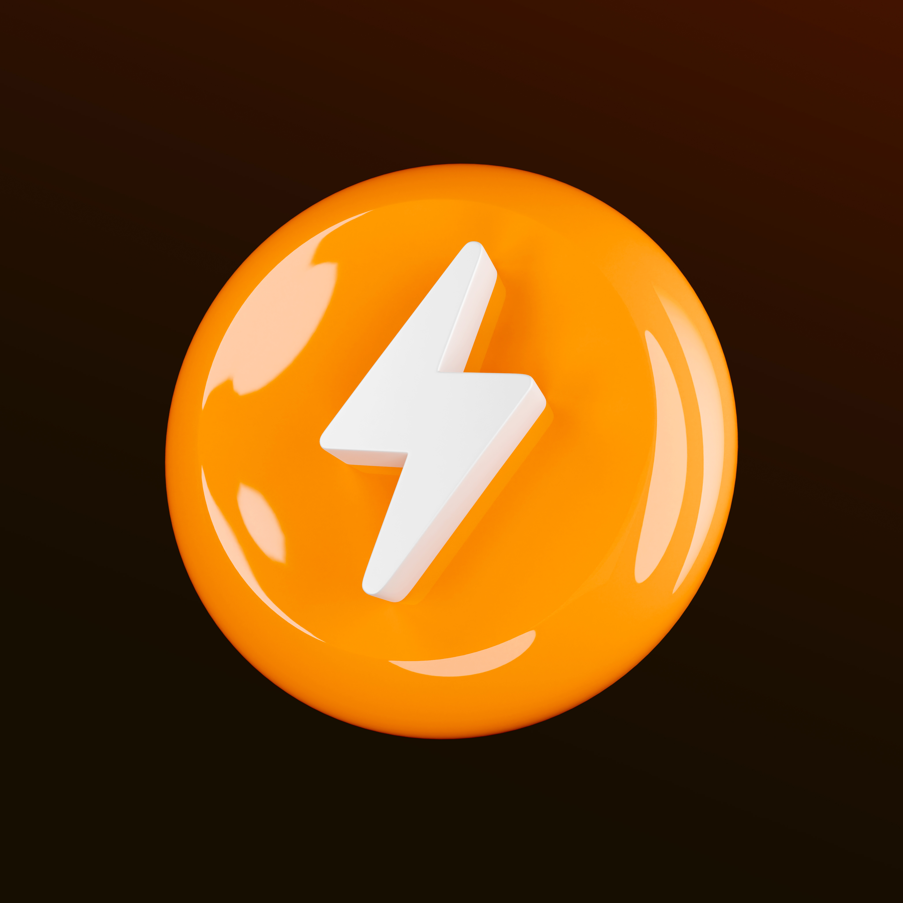
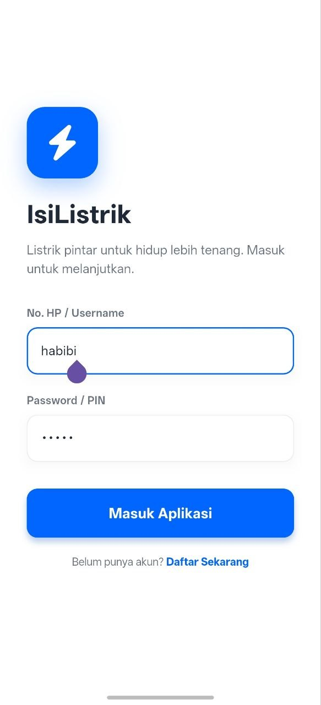
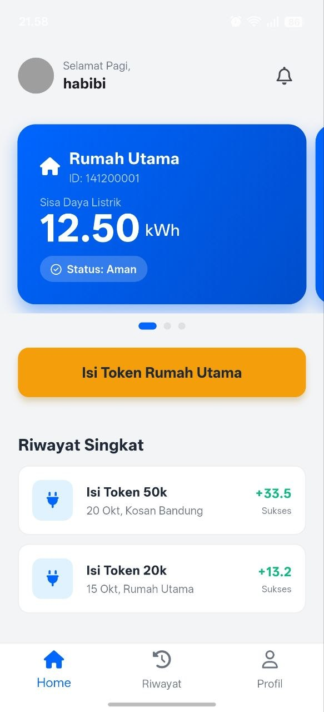
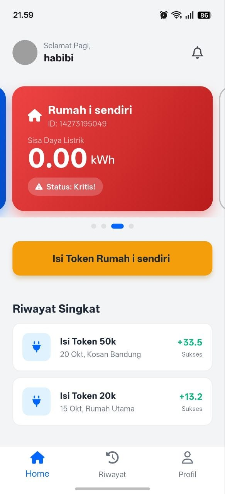
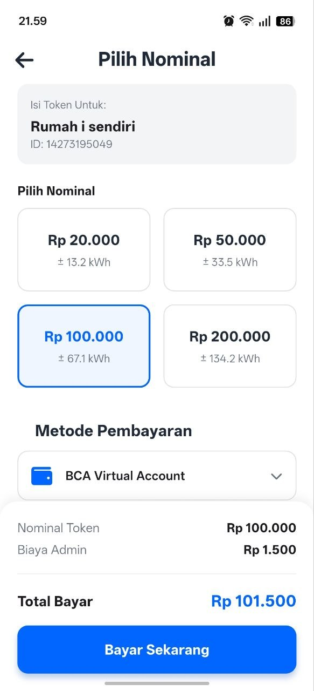
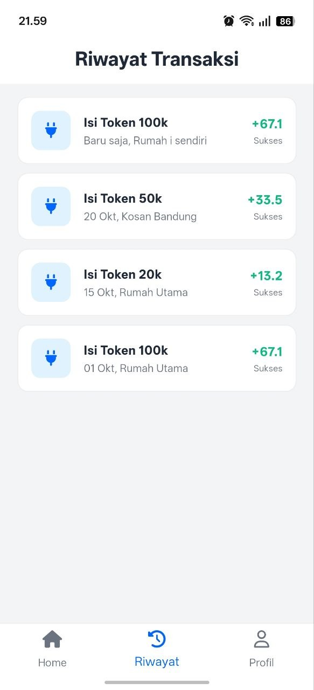
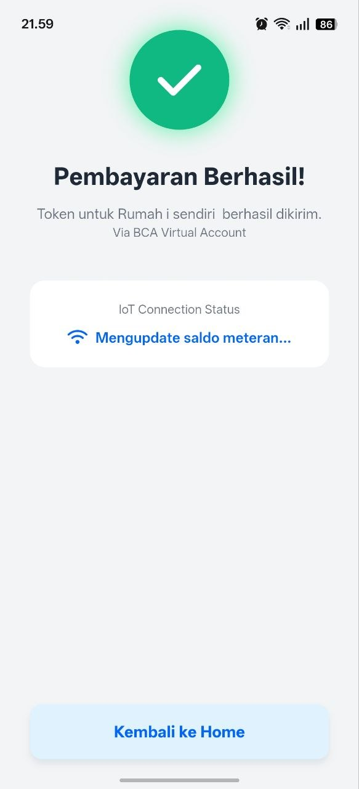

# IsiListrik

A Flutter prototype for viewing electricity meter balances, choosing a token top-up, and reviewing transaction history. Built with Dart, Provider, and a local in-memory data service.



## Features

- View multiple meter cards, balance, and critical-balance state.
- Add, rename, and remove sample meters.
- Choose a token amount and a sample payment method.
- See the balance and transaction history update after a simulated top-up.
- Browse profile, meter management, and transaction history screens.

## Screenshots

| Login | Home | Critical balance |
| --- | --- | --- |
|  |  |  |

| Choose token | Transaction history | Simulated completion |
| --- | --- | --- |
|  |  |  |

## Run locally

Install [Flutter](https://docs.flutter.dev/get-started/install) with a Dart SDK compatible with `pubspec.yaml`, then run:

```bash
flutter pub get
flutter run
```

Select a device or browser when prompted. The login screen is a UI prototype: enter any username to continue. No real account, authentication service, payment gateway, or electricity provider is connected. The password field is not validated or sent anywhere. Meter and transaction changes live only in memory and reset when the app restarts.
